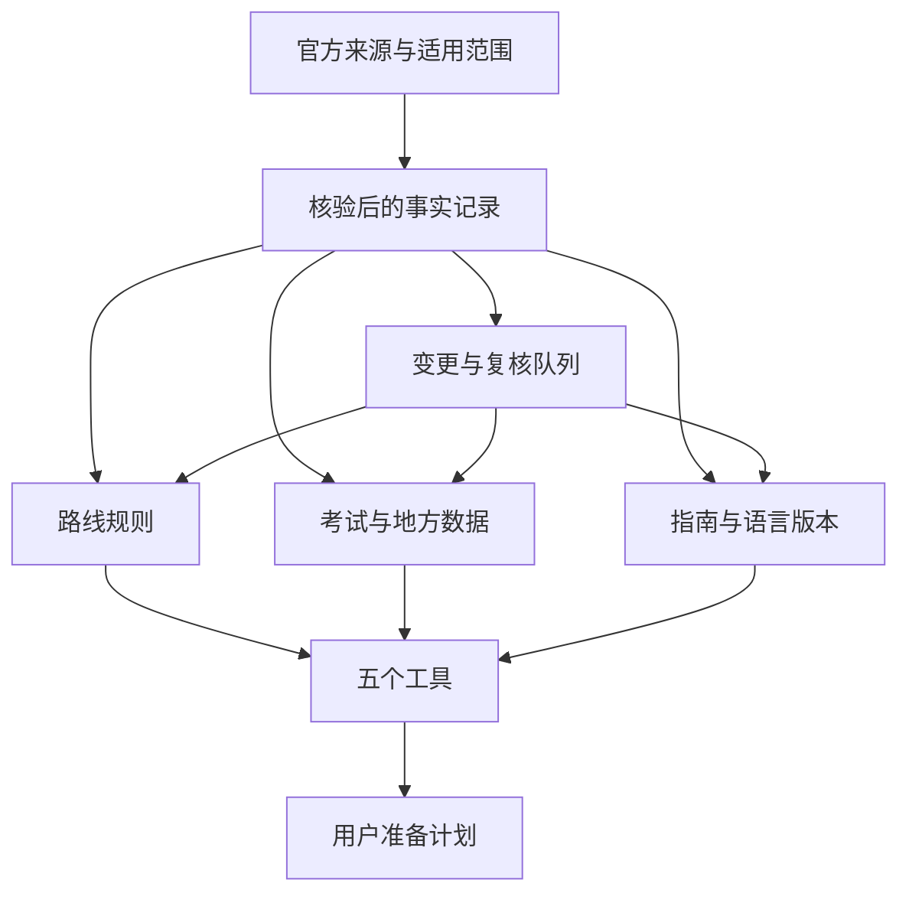

# VisaLang 网站总规划与 Codex 执行规范

## 2026-09-23 多窗口模块提示词交付（当前增补）

Owner要求按现有规划和规划图拆分功能模块，提供可分别发到不同窗口的提示词。[调度规划](../superpowers/plans/2026-09-23-visalang-module-dispatch-plan.md)与[提示词目录](../prompts/2026-09-23-module-build/README.md)提供17个功能窗口、W00集成窗口和W18独立审核窗口。W编号是执行分工，不增加产品里程碑。首次可先分配W01读者准备、W02 Laya初验、W08核心解耦；其他模块按原LP/LC证据条件启动。

每个功能窗口在当前dirty工作树的独立冻结副本工作，提交带基准/候选哈希的局部补丁；W00串行合并共享事实和工具契约，统一完成权威记录、图同步和全量验证，W18独立审核。子模块交付不免除维护窗口治理，不得多个窗口并写主目录或共用构建输出。真人、Linux、账户、目标主机等证据仍需真实获得。

本轮只交付提示词与文档/图状态同步；没有创建执行任务、运行模型、接触读者、改产品代码或改变LP/LC门槛。原T状态25完成/5进行中/4待开始、LP/LC待实施及not_deployed保持。同步ID为`VL-PMAP-20260923-04`，独立审核以`docs/planning-map/VISALANG_MODULE_PROMPTS_INDEPENDENT_AUDIT_2026-09-23.md`为准；旧报告仅证明原冻结窗口。Vault路径缺失时保持blocked与待同步记录；提交/推送/部署/账户/购买仍不在本轮范围。

版本：1.0｜编制日期：2026-09-08｜适用对象：项目负责人、Codex、内容编辑、开发与复核人员。

> 执行方式：按任务依赖逐项实施，阶段完成后提交真实证据。环境已有 Superpowers 时，可使用 executing-plans 或 subagent-driven-development 执行；本文已包含必要工作协议，未安装插件不构成项目依赖。

**目标：** 将 VisaLang 建成围绕德国申请场景的语言证明准备工具站，让用户理解一般要求、找到负责机关、比较考试并保存自己的准备计划。

**架构：** 沿用现有源码、域名、部署方式和视觉基础。公开指南与已核实数据尽量静态生成；五个工具在浏览器完成必要交互，共享最少量计划状态。内容、工具和译文引用同一份可追溯事实记录。

**技术栈：** 历史项目背景为 Astro，尚未取得源码进行本轮确认。Codex 必须先核实仓库；若确为 Astro 则继续使用仓库锁定版本与已有组件方案，不因本规划换成 Next.js、WordPress 或新建站平台。

**依据：** 2026-09-08 公开站点审计、64 个已读取 URL 清单、38 篇主指南、5 个工具样例测试和首批替换文案。本规划规定未来建设方向，不代表线上修改已完成。

## 2026-09-23 并行初验修订（当前阅读入口）

Owner已要求实施“VisaLang 建站规划与全站建设图修订方案”，其中明确：“取消网站、Laya、广告必须同时上线的规划约束；实际发布仍须分别验收并取得授权”。该决定取代9/22强制联合发布顺序，仅授权本轮规划和图更新，不授权产品改造、购买、提交、推送、账户操作或部署。完整依据与依赖见[全站建设规划](../superpowers/plans/2026-09-23-visalang-laya-overall-plan.md)及[内容建设计划](../superpowers/plans/2026-09-23-visalang-laya-content-plan.md)。

最新Owner在询问“laya验证是不是可以提前”并收到并行初验建议后，明确“好的，那就修改规划”。本轮只提前验证的规划顺序，不执行模型实验或读者招募。LP00真实读者任务与LP01a初步Laya技术/对照验证并行安排，不以LP00完成或先证明手选不足作为初验前置；LP01b汇总两路证据后才决定扩大投入、冻结完整评测并进入LP02/03。真人证据缺失不阻塞LP01a，但收益仍未知，不自动扩大投入。

核心主线仍为LP00 → LP04修正A1核心问题 → LP05a核心发布解耦与基础证据 → LP06-core独立候选 → LP07实际运营反馈，不等待LP01a/b。广告走LP05b；各自形成独立候选并保留质量和逐次发布授权门禁。B1深化需要自身需求、来源和维护能力；现有内容维护继续。所有LP/LC工作包均待实施，原T01–T34实际状态仍为25完成、5进行中、4待开始。

当前实现仍是联合候选：发布脚本强制要求Laya和广告。必须先完成核心站在关闭二者时的构建、验收、部署及回滚适配，再审核新的核心候选；规划解耦不等于实现已解耦。模型质量和容量只控制未来Laya启用，广告证据只控制未来广告启用；现有联合脚本不能直接用于绕过这些门槛。

本文件以下正文保留9/8规划基线，其“尚未取得源码”是历史编制状态；当前已确认Astro。9/22已授权的可选Laya目的分类服务保持“用户确认后采用”的有界角色，不扩展为聊天、RAG、自动文章或资格判断。只有family/A1为完整configured工具路线。德国A1、现有中英范围、原网址、每月服务器预算≤100元及索引/广告白名单均保留；新国家、新意图、索引及广告扩张另行决定。9/22联合候选和9/23首次规划审计均保留为对应历史窗口证据，不能充当本次修订或生产就绪证明。

## 阅读与使用顺序

1. 将完整交付包解压到项目可访问位置，保留原始审计材料。阅读本文件和 `VisaLang-Codex-Start.md`。
2. 将本文件放入项目 `docs/visalang/VisaLang-Master-Plan.md`；如果仓库已有统一文档目录，采用该目录并记录实际位置。
3. 将任务表 `VisaLang-Codex-Backlog.csv` 放在同一文档目录；逐页审计表是页面处置依据，不替代任务依赖表。
4. Codex 从 T01 开始工作，先完成本地核实和 P0 修复，再进入内容与工具开发。不要读完总规划后只再写一份空泛计划。
5. 本次规划交付后，由用户在已打开真实项目的 Codex 会话中启动执行。无需向本审计会话提供密码或私钥。

本规划更新的是工作顺序、建设范围和执行要求。历史报告中的事实记录保留；与旧实施提示词发生流程冲突时，采用本规划。最新用户指令与适用仓库约束优先；不能通过修改 AGENTS.md 或忽略已有权限限制来继续工作。

## 1. 网站究竟建设成什么

### 1.1 产品定位

VisaLang 的核心产品是“语言证明准备流程”：围绕一个具体申请任务，把一般规则、考试选择、报名准备、时间安排和可保存清单连接起来。

面向读者的建议表述：

> 准备德国配偶团聚的语言证明：了解要求、比较 A1 考试，并整理报名和材料准备计划。

英文主定位建议：

> Plan your German A1 language proof for spouse reunification.

这是一条定位建议，首页上线时须与实际可用功能一致。网站帮助准备和核对，不根据简短表单保证签证受理、豁免资格、通过考试或出证日期。

### 1.2 为什么先做这一条路线

现有 A1 专题已有七步结构、官方入口和多篇中英文文章，五个工具均能够生成结果。最可行的建设方式是增强已有能力、减少重复输入和空泛说明，使一条流程真正可用。此判断来自站点现状，不等于已经证明搜索规模或盈利能力。

产品价值的顺序是：读者得到明确答案 → 能执行下一步 → 能保存结果 → 愿意回来维护计划 → 在有足够使用证据后评估商业产品。

前 90 天的重点不是扩大国家数量。若同时覆盖各国语言、所有签证、职业执照和备考教育，事实维护成本会超过小团队产能。

### 1.3 目标用户及入口

| 用户状态 | 此时要解决的问题 | 默认入口 | 应能带走的结果 |
|---|---|---|---|
| 刚开始准备配偶团聚 | 我应查哪些要求，哪些身份信息会影响判断？ | A1 路线概览／Route Finder | 一般规则、待核实条件及主管机关入口 |
| 已经有语言证书 | 证书本身规则与材料受理要求是否相同？ | 已有证书分支 | 要核查的产品、日期与受理要求清单 |
| 已确定需要考试 | 选哪个具体考试，哪里报名？ | 考试比较／当地报名入口 | 有依据的比较及当地待确认项 |
| 准备报考或递交 | 还差哪些事项，时间如何倒排？ | 清单／时间工具 | 逐项状态、两种规划日期、日历文件 |
| 已在德国准备长期身份 | 永居与入籍的语言证明有什么不同？ | B1 专题两条独立入口 | 对应路径说明及下一步材料核查任务 |

前四类为首期服务对象。第五类在 A1 核心流程通过验收后深化。学习文章服务这些准备任务，不能脱离申请和考试场景扩成泛德语百科。

### 1.4 默认建设边界

| 范围 | 总规划决定 | 何时可扩展 |
|---|---|---|
| 国家 | 德国优先 | 一个新国家的独立任务、来源、维护人和需求证据均到位 |
| 首条流程 | 配偶团聚 A1；条件判断限定在已核实申请地与身份组合 | 新分支有逐条官方依据、失败状态和回归用例 |
| 第二专题 | B1 永居／入籍分开解释 | 完成具体法律路径与考试产品核验后逐分支上线 |
| 语言 | 英文为主要导航语言，中文优先完善中国申请的核心流程 | 新语言有可持续维护能力，不只机器翻译首页 |
| 地方信息 | 从少数能持续维护的官方报名入口开始 | 当前信息复核队列稳定完成后增加地区 |
| 工具 | 完善已有五个工具 | 新功能需证明现有工具无法解决的高频任务 |
| 账号、数据库、邮件 | 首期不新增 | 出现跨设备同步或真实通知需求且收益能覆盖维护时单独立项 |
| 收费、广告 | 免费核心流程先可用 | 达到第 12 节所列产品与政策条件后评估 |

## 2. 不可偏离的建设原则

1. 一页解决一个可明确表达的问题；一个工具输出一份有用途的结果。不要为相近关键词自动生成多个页面。
2. 先利用现有 38 篇指南，保留有价值的原文、URL、中文本地化和搜索资产。短、流量少或用了 AI 不能单独成为删除理由。
3. 事实先核验，再撰写和编码判断逻辑。来源只支持其适用范围内的主张，不能用机构首页为整篇文章背书。
4. 官方法律或机关受理规则、考试主办方规则、当地考点操作和编辑建议分别标识。
5. 前台显示用户需要的适用范围、核验日期和未确定项；编辑状态、任务编号、内部评分留在工作文档或后台。
6. 所有主按钮到达真实可用功能。没有实现的能力不得靠未来式宣传制造已可使用的印象。
7. 沿用站点现有品牌与可用组件。视觉改动服务阅读、比较和操作，不以大面积模糊、动画、重型 UI 框架作为质量证明。
8. 默认不要求注册，不上传证件，不接收整套个案材料。核心工具可在浏览器完成时不引入外部推理 API。
9. 关键业务规则使用可测试的确定性逻辑；AI 用于研究整理、起草和开发辅助，不充当未经校验的实时签证裁定器。
10. 发布前完成有风险部分的验证；已足够验证的低风险文案调整不应反复加测拖延交付。

## 3. 完成后的用户流程和信息架构

### 3.1 主流程

用户可以从任意文章进入对应步骤，无须全部重新填写。标准顺序是：选择任务，确认适用范围，查看一般要求或待确认信息，比较考试，生成清单，倒排时间，保存结果。

存在三个重要分支：已有证书的人先检查材料受理要求；申请条件不明的人先核实主管机关；本站未覆盖的情形直接给出范围说明和官方查找路径。只有证据覆盖的情形才进入具体规则结果。

每个结果至少包括五块内容：

| 内容 | 具体要求 |
|---|---|
| 本次结果属于什么 | 一般准备路径／需要补充信息／需主管机关确认／本站尚未覆盖 |
| 为什么出现这个结果 | 显示相关选择、规则条件与对应官方来源 |
| 目前能够确认什么 | 列出有依据的一般事实；与待确认项分开 |
| 下一步做什么 | 最多三个当前最有用动作，说明动作完成标准 |
| 如何保存或修改 | 修改选择、复制清单、打印、保存日历；保持必要上下文 |

“条件尚不明确”和“无需语言证明”是不同结果。某项未选择、规则缺失或来源过期，均不得默认为豁免。

### 3.2 保留并改造的入口

| 真实路径 | 改造后的职责 | 内容与动作 |
|---|---|---|
| `/`、`/zh/` | 定位与任务分流 | A1 价值、三类任务、结果示例、真实工具、B1 专题 |
| `/routes/` | 支持范围目录 | 完整流程、信息专题、其他目的分开呈现 |
| `/germany-family-reunion-a1/` | A1 主流程 | 七步顺序、已有证书分支、来源与每步完成标准 |
| `/zh/germany-family-reunion-a1/` | 中文核心流程 | 与中文文章、清单和时间工具衔接 |
| `/germany-b1-settlement-citizenship/` | B1 两类申请分流 | 保留真实存在的永居与入籍卡片，逐条深化 |
| `/guides/` | 按任务寻找文章 | 目的、准备阶段、语言；清晰零结果状态 |
| `/exams/` | 当前支持考试的参考目录 | 德国 A1/B1 具体产品优先；减少无关职业考试占据主位置 |
| `/tools/` | 五个工具入口 | 每个工具写明输入、输出、覆盖范围 |
| `/about/`、`/editorial-policy/`、`/contact/` | 真实身份与纠错 | 运营范围、核验方法、实际联系方式 |
| `/pricing/`、`/partners/` | 当前商业状态 | 未交付服务降低入口权重，保持真实简明 |

继续保留有独立浏览作用的 A1/B1 分类页；路线页承担步骤，分类页承担检索，两者不因主题相同就必须合并。新目录结构不能成为修改全部旧 URL 的理由。

### 3.3 首页与文章页面规格

首页模块顺序：明确价值与主要按钮；“判断要求／已有证书／准备报名”三个任务入口；可用工具的示例结果；A1 核心步骤；少量高价值指南；来源与编辑方法；B1 两类专题；简明页脚。

主按钮建议为“开始整理 A1 准备计划”，次按钮为“我已有语言证书”。正式上线前核对这两个入口确实到达对应流程。示例必须标为示例，不展示虚构用户、结果或政府确认徽章。

文章阅读顺序：标题 → 直接答案 → 适用范围及核验信息 → 主要表格或任务 → 具体解释与例子 → 失败处理 → 相关下一步 → 来源。日期和作者压成简明一行，不把多个提醒框放在主要答案之前。

直接答案的编辑检查：如果用户只看这段，是否已经获得标题要求的信息？费用页应先有已核实报价及其适用范围；比较页先有事实差异；练习页先明确练什么、如何完成。不能把文章摘要改名为“直接答案”。

### 3.4 UI 验收基线

以下是实施目标，不是对当前 CSS 或移动端测试结果的陈述。

| 项目 | 实施与验收 |
|---|---|
| 阅读宽度 | 正文通常约 720–800px；宽屏按真实内容决定是否附侧目录 |
| 字体 | 正文建议不小于 16px，中文适当增加行距；沿用现有可用字体 |
| 页面密度 | 合并重复提示和徽章；一个主要任务保持一个明确主操作 |
| 移动端 | 检查 375、390、768px 及桌面；菜单、表单、清单与表格均可操作 |
| 比较表 | 小屏可控区域滚动或转为逐字段卡片，页面本身不溢出；保留列标题语义 |
| 可访问性 | 键盘完成流程；焦点可见；输入有标签；错误与字段关联；状态不只靠颜色 |
| 触控 | 主要点击目标以约 44px 为设计目标，实际采用的无障碍标准另行测量记录 |
| 结果 | 首先看到答案和下一步；复制成功、空结果、过期数据和失败状态清楚 |
| 打印 | 只打印有用结果；保留路线、逐项状态、来源和生成日期，避免切断表格 |
| 性能 | 先记录现状再优化图片、字体、脚本；没有实际测量不得写性能分数 |

## 4. 内容方向、选题和生产规范

### 内容方向：围绕一条可完成的申请任务组织网站

VisaLang 的内容定位是“德国申请场景的语言证明准备工具与指南”。首条完整路线服务于德国配偶团聚 A1：让读者依次弄清要求、选择具体考试、找到官方报名入口、核对材料、安排时间并保存行动清单。B1 永居与入籍作为第二阶段的两条不同流程建设。网站价值来自解释条件、整理可靠来源和帮助完成下一步，不以文章总量、国家数量或考试品牌数量定义规模。

英文版服务需要用英语理解德国相关流程的读者；中文版首轮重点解决中国申请场景及中文操作障碍。语言与地区分别建模：读者使用中文，不代表其一定在中国递交；英语页面也不代表内容全球适用。界面应允许识别“阅读语言”和“适用地区”，页面标题、结果摘要、报价表都应明确自己的范围。

首期保留五个工具，逐项提高结果质量；费用预算先作为现有文章内的表格或轻量交互，不立项开发第六个独立工具。保持既有 Astro 优先的低成本建设方向，实际接入时核实源码；普通页面用现有内容系统管理，只有筛选、勾选和计算需要浏览器交互。不为发布文章增加数据库、账号、聊天机器人或复杂后台。

#### 内容支柱与页面分工

| 支柱 | 帮助读者完成什么 | 首期内容与工具 | 暂缓范围 |
|---|---|---|---|
| 适用要求 | 找到与自己申请程序和身份有关的语言证明规则 | A1 要求主指南、A1 路线页、Route Finder | 未有完整依据的个案资格判断 |
| 选择与报名 | 区分具体考试，确认当地报名办法 | A1 产品说明、比较、考点、费用、报名前清单 | 全球考点库、实时余位、最低价排行 |
| 时间与材料 | 把阅读结果变成可保存的行动 | 时间表、材料清单、证书核查、日历提醒 | 承诺签证办结日期、代递交服务 |
| 备考与复盘 | 知道练什么、怎么复盘、何时调整计划 | 有独立练习资产的 A1 学习页；后续 B1 训练 | 大量换标题的学习建议、无依据通过率 |
| B1 路径 | 区分永居、入籍、知识测试与语言证明 | 两条路径说明、B1 比较、诊断与复盘 | 以一句“需要 B1”覆盖不同程序 |

首页负责说明“服务谁、可以完成什么、从哪里开始”；路线页负责串起步骤并显示进度；指南负责解释一个具体问题；工具负责生成能使用的结果；分类页负责检索与选读。不要让这五类页面复制同一篇长介绍。`/exams/` 优先呈现已支持路线涉及的具体考试，其他考试信息先列入待维护范围，不因卡片已有链接就宣称提供完整服务。

#### EN 与 ZH 建设顺序

1. 先完成英文 A1 核心事实与产品结构，同时修复中文已确认的事实和编辑错误；再完成中文路线、主指南及五个工具的必要界面文案。
2. 已有八篇中文指南按真实任务维护，不能为凑齐语言页面机械翻译其余三十篇。中国报名故障处理具有独立用途，可以保留；英文报名错误文是否合并不决定中文版必须合并。
3. 两种语言使用同一个事实标识、具体考试标识和版本，表达可以不同。中国考点的价格和报名步骤只出现在中国范围模块；一般要求不从单一考点信息推导。
4. 只有主要任务与适用范围等价的页面互设语言对应关系。若中文是中国专属指南、英文是一般性指南，先检查正文范围是否对应，再决定语言标签与切换说明；不要将“翻译”按钮连接到不同任务页面。
5. 无力维护某个地区时缩小范围，并保留官方查询入口；不要让内容列表自然膨胀为全球签证百科。

### 首批十二项内容任务与 URL 承接

下表路径均相对于 `https://visalang.org`。这里的十二项是用户任务与内容资产，不要求新建十二个 URL；优先改造旧页。中文承接以现有 URL 清单为准，无对应页时先交付文案和工具本地化，是否新增由任务价值决定。

| 编号 | 任务 | 主要既有承接路径 | 顺序 |
|---|---|---|---|
| C01 | 是否需要 A1 | `/guides/german-family-reunion-language-requirement/` | 核心 |
| C02 | Goethe A1 与 telc A1 怎么选 | `/guides/goethe-a1-vs-telc-a1/` | 核心 |
| C03 | 报名前逐项检查 | `/guides/goethe-a1-pre-booking-checklist/` | 核心 |
| C04 | 找到可核验的报名入口 | `/guides/goethe-a1-test-centers/` | 核心 |
| C05 | 理解并估算考试相关费用 | `/guides/goethe-a1-fees-by-country/` | 核心 |
| C06 | 从目标日期倒排准备时间 | `/guides/german-a1-exam-booking-timeline/` | 核心 |
| C07 | 检查已有证书能否用于当前申请 | `/guides/goethe-a1-germany-family-reunion/` | 核心 |
| C08 | 分清报名、考日与申请材料 | `/guides/german-a1-documents-checklist/` | 核心 |
| C09 | 分清 B1 永居和入籍路径 | `/germany-b1-settlement-citizenship/` 及其既有子指南 | 扩展 |
| C10 | 比较具体 B1 考试 | `/guides/goethe-b1-vs-telc-b1/` | 扩展 |
| C11 | 从 B1 诊断生成复习安排 | `/guides/goethe-b1-study-plan/` | 扩展 |
| C12 | 用写作与口语例子进行复盘 | `/guides/goethe-b1-writing-assessment/`、`/guides/goethe-b1-speaking-topics/` | 扩展 |

#### C01：我的申请情况是否需要 A1？

- **读者任务与边界：**识别申请程序、配偶相关身份、现有证明和需要进一步确认的条件；只呈现有依据的分支，不把流程结果写成签证资格审批。
- **正文结构：**适用范围与直接回答 → 哪些信息影响规则 → 基本规则与已核实例外 → 三个明确标为虚构示例的情境 → 无法判断时应核对什么 → 下一步。
- **独有资产：**条件分支表；每条分支具有依据、适用条件、缺失信息和下一步。Route Finder 使用相同分支，不另写一套答案。
- **来源与内链：**法律原文、主管部门解释、适用使领馆材料；链接 C07 已有证书核查、C02 考试选择、C08 材料清单，回链 A1 路线。
- **验收与维护：**每个确定性判断有直接依据；可提供一般帮助、缺信息、需主管机关确认、未支持是四种可辨别结果。由事实核验负责人维护，季度及政策变化时复核；中文中国范围另行核验。

#### C02：如何选择具体 A1 考试？

- **读者任务与边界：**比较成人具体考试产品，理解结构和当地报名条件；不按品牌推定所有证书均被受理，不发布“最容易通过”的主观排行。
- **正文结构：**比较对象 → 已核验差异表 → 听读写说安排 → 口试与重考 → 当地可报性 → 按个人限制选择 → 官方样题入口。
- **独有资产：**独立双列数据表；未知字段显示“尚未核实”，不用跨列提醒代替差异。表格数据同步给比较工具。
- **来源与内链：**主办方具体产品与规则文件；受理问题另用主管机关来源。链接 C03、C04、C05，已有证书问题转 C07。
- **验收与维护：**每个数字、产品名、模块规则可核验；手机版可读；与工具结果一致。考试资料负责人季度复核，产品规则调整时提前更新。

#### C03：提交报名之前应检查什么？

- **读者任务与边界：**核对证件、姓名、产品、考点、费用与退改条件；不混入未注明适用范围的签证材料要求。
- **正文结构：**选择适用机构/地区 → 报名前检查 → 提交与付款 → 报名后确认 → 姓名不一致、付款失败等处理 → 联系前准备的信息。
- **独有资产：**一个动作对应一个勾选项；四类原创错误情境及处理顺序；复制或打印结果保留每项状态、范围和日期。
- **来源与内链：**实际考点报名说明、主办方条款。链接 C04 入口、C05 费用、C08 材料；连接清单工具。
- **验收与维护：**先吸收英文 booking-mistakes 中独有内容，再决定合并；中文故障指南保持独立评估。由报名资料负责人每月检查入口，规则变化时复核正文。

#### C04：在哪里报名，怎么找到真正的入口？

- **读者任务与边界：**在明确覆盖地区内找到主办方或授权考点的入口；目录不表示实时考试日期、余位或签证受理保证。
- **正文结构：**覆盖范围 → 机构、授权考点与报名平台的区别 → 已核验入口 → 一个实际流程说明 → 暂无日期或名额时的操作 → 联系模板。
- **独有资产：**少量可维护的考点记录，含具体考试、城市、官方报名页、证据位置和核验日期；已观察步骤与未观察步骤分开。
- **来源与内链：**主办方授权列表、考点官方页面。链接 C03、C05、C06，不把用户送到泛泛首页后结束。
- **验收与维护：**至少一条选定地区的入口能完成核对；筛选确实改变结果；未知字段如实展示。报名资料负责人每月维护，失效入口优先修复。

#### C05：总共要准备多少预算？

- **读者任务与边界：**区分官方考试费与自行估算的交通、住宿和材料支出；某地价格不得变成全球报价，费用缺失不得按零计算。
- **正文结构：**范围与核验日期 → 已核验报价及类别 → 其他预算项 → 用户填写表 → 首考/重考情境 → 合计与未确认项。
- **独有资产：**沿用审计已核验的北京与德国报价作为待发布前再核查的数据起点；提供可填写的分项预算，而非新增全球费用数据库。
- **来源与内链：**当地官方价目表及退改、重考规定；旅行支出只用用户输入或明确示例。链接 C04、C03、重考政策旧页、C06。
- **验收与维护：**币种、计价单位、考试名称、报名类别和日期齐全；不同币种分别展示，未提供汇率来源时不自动换算。费用负责人每月及价格变化时复核。

#### C06：如何安排考试与递交时间？

- **读者任务与边界：**理解倒排假设并生成自己的准备时间表；规划日期不等于考位保证、机构承诺或签证审理预测。
- **正文结构：**目标日期含义 → 需要填写的时间 → 普通与保守安排 → 每个日期如何算出 → 三个情境 → 临期或无考位时的调整。
- **独有资产：**可复算示例和可保存结果，分别标注官方时间、用户输入及规划缓冲；与时间工具共享说明与算法含义。
- **来源与内链：**选定考点报名、出分、证书领取说明，必要的受理文件。链接 C04、C05、C07 和日历提醒。
- **验收与维护：**空值、过去日期、负数、跨年和缓冲输入可解释；结果不会输出无法履行的确定承诺。产品负责人验算，报名资料负责人季度及周期变化时复核。

#### C07：已有证书还需要检查什么？

- **读者任务与边界：**分开发证机构证书规则、申请机关新近性要求和当前申请条件；不用“永久有效”一句话回答所有受理问题。
- **正文结构：**已有证书分支 → 具体产品与证书名称 → 三层规则对照 → 哪些资料仍需核对 → 保存确认记录 → 无法确认时下一步。
- **独有资产：**证书核查记录表，包含产品、考试日期、拟用于何种程序、受理机关、证据和待确认项；无需上传证书照片或证件号。
- **来源与内链：**主办方证书说明、实际受理机关文件。链接 C01、C08、必要时 C02；保持旧页的 Goethe A1 产品说明，不为新近性另造重复页。
- **验收与维护：**机构规则与受理规则有明确归属；地区示例不被泛化。事实核验负责人季度及受理政策变化时维护。

#### C08：报名材料、考日物品、申请材料有什么不同？

- **读者任务与边界：**分阶段准备语言考试和证明相关材料；网站不自称提供适用所有个案的完整签证材料清单。
- **正文结构：**三种材料集合 → 报名阶段 → 考前一天与入场阶段 → 取得证书后 → 申请机关完整清单入口 → 缺失材料如何处理。
- **独有资产：**按阶段分开的可打印清单；每项只有一个动作，并注明适用机构、可核对来源及是否尚需确认。
- **来源与内链：**考试通知、考试规则和对应申请机关的材料清单。报名操作链接 C03，证书问题链接 C07，时间问题链接 C06。
- **验收与维护：**三类材料不混用，考试当天条目有来源；没有独立价值时不新增“考日清单”URL。内容编辑季度复核，报名资料负责人处理规则变更。

#### C09：B1 永居与入籍先走哪条路径？

- **读者任务与边界：**分清正在办理的程序，再查看对应语言与知识要求；不把语言条件当成申请获批的充分条件。
- **正文结构：**程序分流 → 每条路径涉及的语言证明 → 仍需核对的身份及条件 → 知识测试另列 → 路径清单 → 准备时间。
- **独有资产：**永居与入籍两套独立结果；专题负责分流，入籍证明旧页、知识测试旧页、清单和时间旧页各承接自己的问题。
- **来源与内链：**相关法律、主管部门说明及地方负责机关材料。链接 C10；清单不得共用一份不分程序的结果。
- **验收与维护：**未核验分支保持说明性状态；旧 work 路径须澄清定位，避免暗示就业申请一律需要 B1。事实核验负责人季度及法规变化时维护。

#### C10：B1 考试结构怎样影响选择？

- **读者任务与边界：**比较具体成人考试的模块、形式、成绩与重考安排；不从 A1 规则复制推导 B1。
- **正文结构：**具体产品 → 模块与时间 → 报名和成绩 → 重考及证书输出 → 当地安排 → 按限制条件选择。
- **独有资产：**可核验的双列比较及选考记录表，说明哪些字段属于考试统一规则、哪些取决于当地考点。
- **来源与内链：**主办方产品页、考试规则和当地报名资料。链接 C09、既有 B1 费用报名页、C11。
- **验收与维护：**品牌与考试产品分开；缺失数据不补猜测。考试资料负责人季度及产品变更时维护。

#### C11：怎么知道自己该先补哪一项？

- **读者任务与边界：**用诊断和复盘分配 B1 学习时间；自评结果不能称为官方成绩预测或保证通过计划。
- **正文结构：**选择诊断材料 → 记录表现 → 按任务定位弱项 → 每周时间安排 → 复测 → 调整计划。
- **独有资产：**诊断记录、每周可填写计划和复测表；保留 difficulty 页的难点分析、mock 页的模拟执行用途，只有重复且无独有用途时才合并。
- **来源与内链：**官方题型、公开样题和评分说明；引用链接与自己原创的材料清楚区分。链接 C10、C12 和仍有独有训练的技能页。
- **验收与维护：**计划随可用时间与弱项变化；读者能按表执行一周；不复制整套官方材料。学习内容编辑半年及考试变化时复核，不能虚构教师审稿身份。

#### C12：如何从写作或口语练习中找出具体改法？

- **读者任务与边界：**看懂问题、修改和下一次训练的对应关系；示例是原创教学材料，评论不是官方阅卷结果。
- **正文结构：**任务目标 → 原创初稿/对话 → 问题定位 → 修改后版本 → 修改理由 → 可迁移练习 → 自评表。
- **独有资产：**写作和口语各自至少一组完整原创复盘资产；不能只把“多练习、看官方样题”换成两个标题。
- **来源与内链：**官方能力描述及公开评价标准；示例由内容编辑创作并标注。链接 C11 的对应弱项和同技能练习，不强制塞入报名与费用链接。
- **验收与维护：**语言准确性有真实复核记录；未得到合格复核时保持草稿。学习内容编辑半年检查，产品变化时复核任务形式。

### 现有其他内容怎么处理

十二项任务之外的旧页进入维护队列，不能失去归属。A1 的 30 天计划面向已有基础的冲刺者，在职计划提供每周时间预算和漏学补偿；听力、口语、写作分别需要独立练习和反馈。没有原创音频能力时先交付可核验的官方听力使用指南与原创复盘表，不伪造音频素材，也不立即启动成本较高的音频生产系统。

FAQ 页先把重复问答归到负责回答的主页面，保留独有问题；resources 页把链接整理成“适用产品、练习目的、使用步骤、核验日期”的注释目录。retake 页负责失败后的操作顺序，与普通报名清单区分。分类页只要有独立检索和阅读顺序价值就保留。逐页最终决定记录到原有 URL 整改清单，不能把本章主题相近的任务自动视为跳转指令。

### 内容生产与发布硬规则

内容状态使用“待取证 → 草稿 → 待事实复核 → 待界面验收 → 可发布 → 已发布 → 需复查”。Codex 可以查找来源、整理数据、写稿、集成和运行校验；未经实际核验不得自行把人员署名写成专家、律师、教师或官方审核员。一人可以兼任多个真实角色，复核者名称必须与实际参与一致。

每项任务必须保存：用户问题、主要承接 URL、适用地区、具体考试、关键事实标识、支持事实的来源及位置、独有资产、关联工具、关联译文、负责人、核验日期和下一次复核日期。未知政策生效日期保留为空；抓取日期不能冒充生效日期。

来源按事实类型选择：申请条件查主管机关；考试结构和证书规则查主办方；价格、报名、退改查实际考点。论坛与用户反馈可用于发现问题，不能直接作为政策结论依据。官方链接可访问不等于条款仍然支持原文，复核必须阅读相关内容。

每篇上线前回答六个验收问题：标题问题是否在开头获得清楚回答；范围是否明确；关键事实能否追溯；是否有独有可使用的结果；下一步是否可以操作；正文、工具和译文是否一致。存在关键错误时不得用总评分抵消。篇幅由完成任务所需决定，不设最低字数、固定 FAQ 数量或“每周必须发布几篇”的指标。

删除与跳转单独登记。只有承接内容已经完成、历史价值和内链已检查、预览验证通过，才能执行对应 URL 变更。未接入 Search Console 时只记录“尚无数据”，不能写成“无流量”。页数减少、发布日期变新和页面变长都不作为整改成功的证据。

### 第 61–90 天的扩展门槛

第 61 天先复盘已有路线的任务失败点，不默认追加国家或文章。内容扩展申请必须同时说明：真实用户问题证据；现有页面不能解决的原因；可靠来源；独有交付物；维护负责人和时间预算。搜索数据、匿名任务测试和内容更正请求均可作为线索，不能编造搜索量或收入来通过立项。

| 扩展动作 | 必须先满足的条件 | 满足后的小批次试行 |
|---|---|---|
| 增加中国境内城市/考点 | 现有入口与价格没有逾期未查记录；新考点有直接官方来源 | 先加一处，完成报名、费用和时间关联 |
| 补充 B1 路径 | A1 八项核心内容通过验收，未解决的关键错误清零；B1 对应证据完整 | 先完成一个程序的语言证明任务，再扩展下一分支 |
| 新建学习内容 | 有真实弱项反馈、独立练习资产及语言复核能力 | 一次新增一组练习，观察能否帮助读者完成复盘 |
| 增加中文页面 | 原页面任务稳定；中文读者存在相同或独有需求；有维护安排 | 优先补关键工具解释与失败路径，再新增文章 |
| 增加其他国家或签证目的 | 德国既有范围能持续维护，有明确需求与完整来源链，产品负责人重新确认范围 | 只做一个明确任务的试点，不批量复制路线 |

第 90 天输出内容资产台账、逾期复核清单、用户未解决问题和下一周期候选任务。商业内容不得影响事实排序；未来联盟推荐须有实际合作与披露，收费资料必须比免费指南增加可交付价值。当前不将广告通过、订阅收入或付费转化列为内容完成的保证性目标。

## 5. 内容整改如何落实到现有页面

先处理事实错配、内部编辑残留及误导性范围，再补充实际答案和独有内容。改写不是将同样提醒换一种说法，也不是把每篇延长到固定字数。

逐页执行以下过程：

1. 在 `VisaLang-url-remediation.csv` 找到 URL，并在源码中找到实际内容文件与模板。
2. 记录原页面解决的任务、被哪些入口使用、哪些具体内容值得保留。
3. 填写改稿 brief：目标问题、适用范围、需要的事实、独有产出和关联工具。
4. 阅读直接官方依据，登记支持的结论与不足；修正文案后核对工具使用的同一事实。
5. 完成新正文和相关表格/练习，不显示编辑操作指令、空表、虚构数值或未实现按钮。
6. 验证链接、语言配对和主流程，再决定是否需要合并或索引变更。
7. 记录变更目的、涉及 URL、事实版本与测试证据，更新任务状态。

| 页面组 | 总规划处置 |
|---|---|
| A1 要求、证书、比较、费用、考点、清单、时间 | 保留主要 URL，重写为互有分工的准备任务 |
| 英文报名错误与报名前清单 | 先迁移独有故障处理；确认没有独立需求且完成流量/外链核查后，才实施等价合并 |
| 中文报名错误 | 单独评估中国申请场景，不能跟随英文机械跳转 |
| FAQ | 有用问答归到对应主题；真正独有问题可保留，不统一跳到不覆盖问题的页面 |
| 30 天与在职学习计划 | 按起点、可投入时间和训练产出区分；只有任务实质相同才整合 |
| 听力、口语、写作 | 各自提供能完成和自评的训练；缺产能时逐项深化，保留已有可用内容 |
| B1 诊断、计划、模拟 | 分别回答差距、如何安排、如何演练，不复制三套同义长文 |
| 暂缓研究页 | 建立完整清单，验证实际 head 与发现入口；补足依据前不主动扩大分发 |

没有 GSC 时，继续重写、完善承接页和记录拟迁移映射；不要把缺数据写成“没有流量”，也不要因此停止所有可做工作。不可逆删除和大批 URL 迁移暂不自动执行。

## 6. 技术路线与源码工作边界

### 6.1 第一次进入仓库必须确认的事实

检查仓库根目录、分支、未提交改动、AGENTS.md、README、包管理锁文件、依赖与运行版本、页面路由、内容来源、脚本、测试工具、环境变量名称及部署配置。只读取必要的配置内容，不在日志或报告输出密钥。

输出一张“职责 → 现有文件 → 拟修改文件 → 验证命令”的映射。下面是职责设计，不是声称仓库已存在这些目录；未找到真实文件前，不生成针对虚构路径的补丁。

| 职责 | 推荐组织方式 | Codex 需要确定的实际位置 |
|---|---|---|
| 指南正文 | 继续使用已有 Markdown/MDX/内容集合 | 38 篇主指南及暂缓研究页的真实来源 |
| 关键事实 | 结构化记录及校验器 | 当前是否已有数据文件、schema 或内容模型 |
| 路线判断 | 与 UI 分开的规则函数 | Route Finder 现有逻辑及其调用位置 |
| 考试数据 | 按具体产品组织记录 | A1/B1 比较表和目录当前数据来源 |
| 清单与时间 | 纯函数生成结果，组件负责交互 | 当前实现、可复用组件和现有测试 |
| 语言文案 | 复用当前 i18n 方式 | 路由、词典、语言切换及 hreflang 生成逻辑 |
| 来源展示 | 统一的来源标记或组件 | 模板中核验责任、日期、作者和引用位置 |
| URL 与索引 | 修改合法的源配置入口 | canonical、robots、sitemap、重定向的生成方式 |
| 项目记录 | `docs/visalang/` 或现有文档目录 | 任务、来源、决策、迁移、验收和交接文件 |

### 6.2 默认技术选择

若项目确为 Astro，文章和公开资料保持静态 HTML；仅在路线、清单、日期和比较等确有交互的区域运行客户端逻辑。沿用已有 React、Vue 或原生脚本，不为五个表单增加多套组件框架。Astro 的内容集合可用于结构与字段检查，具体 API 以仓库版本为准。[Astro Islands](https://docs.astro.build/en/concepts/islands/)、[Astro 内容集合](https://docs.astro.build/en/guides/content-collections/)

首期使用现有主机与域名。没有证据表明必须购买 VPS、迁移平台或增加数据库；如果现有架构无法支持某个目标，先说明具体限制和最小改法，再单独评估。不要为路线选择器搭建 AI 对话后端。

搜索继续使用现有实现或简单静态索引；无需为几十篇指南采购外部检索服务。打印与 ICS 下载优先在浏览器生成，不以服务器 PDF、邮件发送、任务队列作为基础依赖。

### 6.3 特别保护的项目位置

历史项目约束包括不直接修改 `dist`、`deploy`、`_headers`、`_redirects`。Codex 默认保留这一边界，先核对仓库最新说明和用户指令：

- 构建产物由正常构建生成，不手工修改后当成源码提交。
- 找到允许修改的内容、模板与源配置层，不通过更改同名文件副本绕过约束。
- 若某项重定向只能修改受保护位置，先完成承接内容、映射和验证方案，把该配置动作登记为明确阻塞；其他工作继续。
- 构建会重生成受保护产物时，遵守仓库正常工作流，区分自动产物更新与人工编辑；不擅自提交产物。
- 不覆盖用户未提交修改，不强制推送，不因本次整改顺手升级所有依赖或重构无关模块。

## 7. 数据、事实与跨工具状态契约

以下是需要实现或映射到现有模型的字段契约。它们是设计要求；数据库并非必需。

### 7.1 事实记录



同一事实只维护一份权威记录，文章、工具和语言版本引用它；避免各页面复制后逐渐出现不同结论。图中的“权威记录”指本站内部数据来源，不表示本站是官方机构。

| 字段 | 含义与校验 |
|---|---|
| `claimId`、`version` | 稳定标识与递增版本；同一事实变更可追溯 |
| `statement` | 单项、可核对的结论，不把多个不同责任主体合并成一句 |
| `scope` | 国家、申请地/主管机关、申请类别、身份条件、具体考试产品等适用条件 |
| `sourceRefs` | 具体 URL、标题、发布机关、章节/条款定位；支持与结论相匹配 |
| `sourceCheckedAt` | 实际查看并核对的日期；不能自动取文件修改日 |
| `effectiveFrom`、`effectiveTo` | 来源明确说明时才填写；未知为 null |
| `nextReviewAt` | 内部下次核查日期；不是政策失效日 |
| `status` | draft、verified、needs_review、withdrawn；只有当前范围内 verified 项用于确定性规则 |
| `reviewedBy` | 实际执行核验的人员或过程标识；不得虚构专家资历 |
| `usedBy` | 使用此事实的内容、规则、产品和语言版本 ID |

费用记录另含数值、币种、考点、具体产品、考生类别和价目适用期；未知金额使用 null，禁止默认为零。前台先显示各地事实，跨币种预算换算不是首期功能。

### 7.2 规则结果契约

路线结果采用四种状态：`guidance_available`、`needs_information`、`needs_authority_confirmation`、`unsupported`。状态表示本站能提供何种准备帮助，不表示官方作出了受理决定。

每个规则包括：`ruleId`、适用输入条件、优先顺序、引用的 `claimId + version`、结果状态、解释、待确认项和下一步 ID。来源不足、规则冲突或关键条件未知时，返回待确认状态，不默认选择要求最少的分支。

规则更新流程：修改事实并升级版本 → 查出使用页面和工具 → 更新对应规则与译文 → 执行受影响用例 → 发布同一批一致内容。复核逾期触发内部任务；已证实失效的关键规则应收起确定结论或降级为核查任务，不能因为链接还能打开就继续展示。

### 7.3 最小计划状态

| 字段 | 用途 | 保存策略 |
|---|---|---|
| `schemaVersion` | 兼容新旧保存格式 | 不兼容时提示重新确认，不静默误读 |
| `locale`、`routeId` | 语言和准备路线 | 固定枚举；工具之间共享 |
| `ruleVersion`、`claimVersions` | 判断依据版本 | 事实更新后要求重新确认受影响结果 |
| `answers` | 当前分支所需枚举选择 | 只保留判断必需项；不含姓名、证件、自由文本 |
| `selectedExamIds` | 比较与报名计划 | 用产品 ID，不能以机构名称代替考试产品 |
| `targetDate`、`buffers` | 时间规划假设 | 日期可为空；缓冲为校验后的非负整数 |
| `checklistState` | 每个条目的完成情况 | 稳定条目 ID 对应布尔值；新条目默认未完成 |
| `savedAt`、`savedUntil` | 用户主动保存的时间与期限 | 默认会话内使用；可选本设备保存 30 天并明确告知 |

默认会话内共享状态；用户点击“在本设备保存”后才持久化上述必要信息，并提供“清除计划”。共享链接默认只含非敏感的预设路线、语言和考试 ID；用户输入、身份细节、日期和清单完成状态不自动写进网址。下载文件是用户主动保存，下载前提示其中包含自己选择的计划信息。

已有旧查询参数要验证并迁移到内存状态，然后清理地址栏；此动作无法消除此前已经产生的服务器日志，因此不得宣称旧信息已从所有系统删除。统计代码必须先做属性白名单过滤。

## 8. 五个工具的实施规格

### 8.1 Route Finder：决定从哪里开始准备

输入分步提问：申请目的、申请地/主管范围、影响规则的身份类别、是否已有证书。只在选择考试和时间规划时询问当前水平与目标日期，允许日期未知。自由文本申请地改为有限已支持选项加“不在列表／不确定”。

输出采用第 7 节四状态；展示一般规则、选择摘要、依据和下一步。只对已核实分支计算具体结果；未支持的国家、父母/子女团聚和其他申请目的，按实际配置显示范围说明，不能默认套用配偶 A1。

验收情境：已覆盖普通情况、已有证书、身份条件未知、需要主管机关确认的例外、未覆盖目的、来源失效。每个具体法律结论的预期结果必须从事实台账生成，不在本规划凭空写“必免考”的测试断言。

### 8.2 Checklist：让结果能逐项完成

清单分组为“确认要求、选择考试、报名准备、考前与出证、提交前核查”。每项包含稳定 ID、一个动作、完成标准、适用条件、相关来源和可选备注说明。生成多少项由任务需要决定，不强制凑数。

考试报名材料与签证递交材料分开；本站未覆盖的签证材料仅提供主管机关入口，不能生成伪完整材料清单。勾选、修改路线、刷新、复制、打印与重置应保持一致。

复制格式示例（为产品行为样例）：

```text
VisaLang 准备清单
路线：德国配偶团聚 A1
生成日期：2026-09-08
[x] 已找到负责申请地的官方要求页面
[ ] 已核对所选考试产品及报名条件
[ ] 已确认当地考试费用和出证时间
完成：1/3
依据：列出实际使用的来源和核验日期
```

实际条目必须引用真实已配置内容；测试至少检查不同勾选组合、返回修改导致的不适用项、复制失败后的替代方式和打印分页。按比例显示进度只表示清单完成情况，不表示签证成功概率。

### 8.3 Exam Comparison：提供可核实的产品差异

首批为 Goethe 成人 A1 与 telc 对应成人 A1 产品；B1 比较在具体产品核实后增加。字段包括准确名称、考试组成与时长、口试形式、通过/模块规则、重考结构、官方样题、当地报名与费用核查入口。

考试主办方的稳定规则与各考点价格、日期分区显示。未知字段标为未核实或暂不展示；不让整行共享提醒代替两个产品的数据。相同考试不能形成伪比较，提示选择另一产品。

验收：A1 两列至少提供已核实的结构、时长、口试和重考等实际差异；每个关键字段有直接产品依据。表格键盘可读、手机可用；不根据证据不足的“容易程度”自动推荐考试。

### 8.4 Timeline：清楚呈现假设和倒排结果

输入为目标日期 D、出证等待 W、文件准备 P、重考余量 R。首期统一使用自然日并在字段旁说明，不自动计算当地工作日和节假日。三个天数输入是规划假设或用户查到的当地信息；留空、负数、小数和无法解析日期要明确处理，不自动吞掉输入错误。

基础规划日期 = D − W − P；增加重考余量的规划日期 = D − W − P − R。显示公式及参数。R 只是额外余量，不能保证已经包含真实下一场考试、报名和再次出证所需时间；文案不把它称为完整重考保证。

为兼容旧界面，可以迁移字段名，但主结果不使用暗示官方保证的“最晚安全日”。结果落在今天以前时显示已无法按此假设安排，并引导重新选择参数或实际场次。

必须采用日历日期运算，避免通过本地时区解析 ISO 时间戳导致日期前移。测试预期：2026-12-15、W=14、P=7、R=30 → 2026-11-24 与 2026-10-25；另覆盖跨年、闰日、无目标日期、零缓冲、非法日期、超大输入和正负时区。以受控的“今天”测试过去日期逻辑。

### 8.5 Reminder Planner：下载可用日历文件

保持现有 URL `/tools/email-reminders/`，前台统一说明是日历提醒；URL 改名非首期必要动作。用户选择预设任务、日期和路线，即可复制提醒或下载 ICS；不新增邮件后端。

全天提醒使用 DATE 值，结束日期按日历规范设为次日，UID 对同一事件保持稳定且不含个人信息。转义文本中的换行、逗号、分号和反斜线，采用 CRLF 并按规范折叠长行，包含工具来源和实际官方链接。不要把任意自由文本拼成结构指令，也不要自动访问用户提供的 URL。具体文件格式按 [iCalendar RFC 5545](https://www.rfc-editor.org/info/rfc5545/) 实施；创建日历事件不代表设备一定弹出通知，提醒设置以实际客户端为准。

验收：实际下载文件、验证结构和日期；在可用的真实日历客户端导入，不仅确认按钮存在。没有第二种客户端时如实记录只验证了一种，保留兼容性待验项。检查正负时区的全天日期、特殊字符、重复导入和错误日期；不得写“邮件已发送”。

## 9. 内容与工具的一致性、SEO 和质量门槛

### 9.1 双语与适用范围

英文页面不自动代表全球适用。中文页面也不自动代表只在中国申请，两者必须分别标明地区与用户任务。

当前 A1 要求文章的中英文 hreflang 配对可用；如果重写后中文变成“中国专属指南”而英文仍是全球概览，需重新判断是否仍为等价页面。必要时保留配对概览，再单设有独立用途的本地指南；不能一边改变页面主题一边机械保留 hreflang。

真正等价版本各自 self-canonical、双向 hreflang；未翻译页面不要伪造语言版本，也不要全部指向语言首页。语言切换显示目的地语言，无等价文章时说明进入该语言专题，避免静默跳转。[Google 多语言页面指引](https://developers.google.com/search/docs/specialty/international/localized-versions)

### 9.2 索引、迁移与结构化数据

公开实用内容通常保持可索引。私有计划结果不应形成大量可索引参数页；canonical、参数规范化和 noindex 按实际页面性质选择，三者不能互相替代。

合并先完成承接内容，再验证单跳永久重定向、目标有效状态、内链、sitemap 与语言映射。没有等价目标的页面不得统一跳首页。noindex 页面需允许抓取才能让搜索引擎看到指令，robots.txt 阻止抓取不等于取消收录。[Google noindex](https://developers.google.com/search/docs/crawling-indexing/block-indexing)、[URL 迁移](https://developers.google.com/search/docs/crawling-indexing/site-move-with-url-changes)

标题、描述和结构化数据必须与可见内容一致；真实署名和来源比填满 schema 更重要。采用现有 Article、Breadcrumb 等可用结构，不以添加 schema 承诺富媒体结果，不编造评价星级、资格或审核专家。

### 9.3 五项发布硬门槛

- [ ] 标题问题获得直接回答，读者能完成一个明确任务。
- [ ] 关键事实有直接依据，适用范围与责任主体正确。
- [ ] 有可用的表格、例子、练习、清单或工具结果，具体形式按任务选择。
- [ ] 页面、相关工具与译文不存在已知事实冲突，按钮与链接可用。
- [ ] 无内部编辑指令、虚构数据、空表、未完成占位和未经验证的能力宣传。

内部评分可沿用任务完成30、事实证据30、独有产出20、页面分工10、使用体验10，85分为建议复核目标；关键事实错误不能靠其他项目加分抵消。这是内部管理方法，不是 Google 评分标准。Google 强调实际帮助且没有偏好字数，批量换写和自动更新日期不能代替内容改进。[以人为本内容说明](https://developers.google.com/search/docs/fundamentals/creating-helpful-content)

## 10. 90 天路线图、阶段成果与任务依赖

时间按成功取得源码并开始投入工作后计算，是排期建议，不是自动定时任务或无条件上线保证。每天不是硬等到下一天；已满足依赖就可继续下一任务。

| 阶段 | 对应任务 | 主要成果 | 完成门槛 |
|---|---|---|---|
| M0：第1–2天 | T01–T02 | 真实源码地图、现状基线、工作分支和执行记录 | 代码可运行或已有故障清楚可复现；没有覆盖用户改动 |
| M1：第2–7天 | T03–T09 | P0纠错、来源模型、范围文案、文章与首页首轮改进 | P0已知错误清除；首屏有真实答案；可审阅预览 |
| M2：第8–21天 | T10–T19 | 8项A1核心内容、共用状态、路线/清单/比较/时间/日历完善 | 一条从进入到保存结果的完整流程通过风险用例 |
| M3：第22–30天 | T20–T23 | 核心中文流程、分类整理、SEO核实、条件迁移 | 双语范围准确；移动端和迁移检查有证据 |
| M4：第31–45天 | T24–T26 | B1分流、具体考试比较、原创训练资产首批 | 证据完整的分支才支持；练习可以实际完成 |
| M5：第46–60天 | T27–T31 | 统计、用户任务测试、修复、发布候选和维护记录 | 关键流程无已知阻塞；残余问题与回滚说明完整 |
| M6：第61–90天 | T32–T34 | 来源维护、真实需求复核、下一季度范围与商业试验方案 | 依据实际数据决定扩展；不按规划页数机械发文 |

T03 P0纠错不等待完整设计系统或全部来源模型。T05共享事实模型需在依赖它的工具重构前完成。T20语言同步跟随已稳定核心能力，不提前翻译尚未核实规则。T23迁移依赖内容承接、索引基线和合法配置入口。

任务表的 `depends_on` 是实施所需的前置任务；`conditional_or_related` 是发布范围、外部访问条件或关联工作，不自动阻塞全部后续任务。较大任务包含已完成与被阻塞子项时，拆成有独立验收的子任务并更新依赖，不把整项标完成来绕过门槛。T19 日历客户端导入受阻时，中文界面和其他工具照常推进，但受影响日历能力的验证状态必须保留，不能默默当作已通过。

### 10.1 前七天的具体工作顺序

| 顺序 | Codex应完成的动作 | 留下什么证据 |
|---|---|---|
| 1 | 读适用规则，记录分支和改动；定位当前首页、指南和工具 | `source-map.md`、运行结果、实际文件位置 |
| 2 | 保存被修改内容的可恢复版本；修正已证实责任错配和中文编辑残留 | 具体差异、来源对应关系、受影响页面截图 |
| 3 | 建立最小事实记录与支持范围表；将未配置目的改成真实状态 | 字段校验结果、规则条件与入口状态表 |
| 4 | 改造首页和文章直接答案；集成首批已交付文案 | 桌面及窄屏实际效果；标题问题检查 |
| 5 | 完成最小计划状态及A1路线到清单的传递 | 至少一个正常流程及缺信息分支证据 |
| 6 | 拆分清单，补比较事实，解释时间输入；验证复制结果 | 逐项状态文本、两列事实、日期复算 |
| 7 | 集中修复实测问题，整理预览和未完成项 | 第一批可审查成果，不宣称全部90天任务已完成 |

### 10.2 工时和低产能方案

延续审计中的初始估算：前60天约120–180人工小时，基于沿用现有站点、有限地区和现有五工具。增加完整学习资产、复杂条件判断或新语言会额外增加工作；取得源码后重估。

每周可投入15–23小时，可将60天作为工作目标；每周仅10小时，按12–18周推进同等范围更合理。前七天承诺的是一条流程的可审查改善，不能把完整重写、全面翻译和所有边界测试压成已完成。

产能不足时保留A1要求、已有证书、报名清单、真实比较、费用和时间；B1深入规则、新练习、商业试验后移。沿用已有基础设施，不为按期展示而采购不必要系统。所有需要付费的新服务先给出明确用途、成本和替代方案，用户未授权支出时不得自行购买。

## 11. Codex 工作协议与可持续交接

1. **先识别真实项目。**读取适用的 AGENTS.md、README、依赖、内容模型、路由和部署配置，记录分支、未提交改动与基线构建。沿用现有栈；历史 Astro 信息仅供定位。不得覆盖用户改动，不直接编辑 `dist`、`deploy`、`_headers`、`_redirects`。需要调整路由时，先找受支持的源码入口；没有入口则提交精确映射和阻塞说明，继续其他工作。

2. **以任务及依赖推进。**每项记录 ID、目标、前置项、涉及页面、验收、证据、状态和阻塞。任务状态使用 `pending / in_progress / blocked / completed`，发布状态另用 `not_deployed / preview_verified / release_ready / deployed`；代码写完不等于验证通过，预览通过不等于线上发布。优先级是事实错误、核心流程、内容独有价值、视觉细节。依赖顺序为来源事实→规则数据→内容与工具→交互验证→迁移→发布复核。

3. **合理自主实施。**目录命名、组件拆分、文案精简等可逆选择由 Codex 决定并记录，不逐项询问。缺少统计权限时继续完善内容；无法日历导入时继续生成并校验 ICS，保留导入待验。关键规则无法核实时先收敛为待确认结果；只有无法通过缩小范围继续的必要信息、受保护文件或超出已有授权的发布动作，才提出最小必要问题；不得把整项工程停在计划阶段。

4. **遵循当前授权。**本次交付的是规划。后续拿到仓库后，本地修复、分支、预览、回归可按执行任务直接完成；上线与外部迁移遵循当时明确授权及仓库流程。已有部署授权且门槛通过时继续发布，不重复索取许可；只有预览授权时交付可审查版本，不把计划解释为发布授权。

5. **用证据交付。**每批提供改动文件、受影响 URL、来源版本、构建/测试命令与结果、关键截图、剩余风险和回滚点。先记录已有失败，避免误判新变更。只增加覆盖真实风险的测试，完成门槛后不无限扩大测试。说明哪些已改稿、已集成、已验证、已发布，禁止笼统写“全站完成”。


### 11.1 项目内应持续维护的最少记录

| 文件职责 | 内容 | 更新时间 |
|---|---|---|
| 总规划 | 本文及明确批准的范围变更 | 产品方向发生真实改变时 |
| 任务表 | ID、依赖、状态、实际文件、验收证据、阻塞原因 | 每个任务产生实质进展后 |
| 来源台账 | claim、来源、范围、核验日、版本、使用位置 | 事实新增或改变时 |
| 决策记录 | 为什么保留/合并页面或选择某实现 | 做出影响后续工作的选择时 |
| 迁移映射 | 旧URL、目标URL、理由、验证与回滚 | 每批URL变更前后 |
| 验收报告 | 运行环境、命令、用例、结果、截图、未测范围 | 每个可交付批次 |
| 交接摘要 | 已完成、当前任务、下一任务、明确阻塞 | 每次结束或上下文接近上限时 |

文件名可以适配仓库惯例，不并行维护多套相互矛盾的任务状态。小修改记录在现有任务即可，无需每改一句话新增长报告。

### 11.2 任务完成定义

每个任务按“确认输入与真实文件 → 实施最小可用改动 → 验证具体风险 → 复核差异 → 更新状态”执行。任务表中的 completed 表示该任务交付物已验证；preview_verified、release_ready、deployed 等发布状态另行记录，不以任务完成推导线上已经更新。

已有测试优先复用；规则、日期、状态恢复和导出需要有意义的自动化用例。简单文案与间距修改用构建、实际页面和人工检查足够时不新增形式化测试。测试失败先确认是否由本次引入；既有故障单独登记并处理与目标相关的部分。

如果出现权限拒绝或外部服务不可用，记录动作、原因和影响，继续无依赖工作。不能通过换工具、改安全配置或修改项目规则来绕过限制，也不能把没有测到写成已通过。

### 11.3 发布和回滚

这次请求是编制总规划；默认交付代码分支、预览和发布候选。用户已经明确授权具体环境的发布时，Codex 在该范围内验证后执行，不重复索要同一授权；未授权时先完成全部可审阅成果，再一次性说明待发布变更、风险和回滚方式。

上线前记录发布版本、改动URL、来源版本、迁移映射和恢复方法。权限允许时在上线后核对首页、首条流程、核心文章、来源、语言配对、重定向和统计，区分构建成功与实际线上验证。

错误资格结论、错误关键金额、核心流程中断、批量非预期404、语言错误指向或数据泄露，需优先停止受影响能力并按已授权回滚流程恢复。普通短期排名波动不单独触发全站回滚。保留未受影响的修复，记录事故及防止复发的用例。

## 12. 获客、商业模式与后续方向

### 12.1 先验证使用价值

首批流量承接围绕真实任务，如语言要求、已有证书、A1考试比较、当地报名、费用和倒排时间。已有公开审计不能证明搜索量、商业回报或竞争强度；这些是假设方向，后续用GSC查询、用户提问和实际使用补充。

增长优先改进现有有展示但任务未被满足的页面、工具失败的步骤和用户反复询问的问题。社区研究只整理公开问题与任务，不伪装真实经历，不自动向他人发消息或批量投链接。新增内容前在已有目录检索，能更新旧文就先更新旧文。

### 12.2 商业模式顺序

| 阶段 | 可以准备什么 | 启动条件 |
|---|---|---|
| 免费核心产品 | 文章、比较、清单、时间与日历 | 第一阶段即完成，不以注册或付款阻断主要任务 |
| 展示广告 | 仅评估具有实质内容的合适页面与版位 | 实际内容和使用体验达标，账号权限与适用政策确认；不保证过审 |
| 相关联盟合作 | 考试准备资源或相关学习服务的透明推荐 | 确认真正存在的合作、资格、条款和用户适配；佣金不影响规则结论 |
| 一次性数字产品 | 原创练习包、带讲解的准备记录模板等小型产品 | 用户反复需要额外产出；已有可检查样品、交付方式和服务说明 |
| 订阅或服务 | 以后单独论证 | 有持续使用与维护价值，且收入足以支持更新和服务，不先搭会员平台 |

广告不是通过增加低价值文章获得的页面填充奖励。Google 发布商政策对低价值、缺少发布者内容和建设中页面有明确限制；能否获批以真实站点与审核为准。[Google 发布商内容政策](https://support.google.com/publisherpolicies/answer/11112688?hl=en)

前90天不设置无依据的收入承诺、价格、佣金率或月访问量目标。不销售保证通过、保证免考、代办资格判定或伪官方核验；如果未来提供专业服务，应作为独立业务明确能力、责任和适用要求。

### 12.3 最小测量体系

| 指标 | 定义 | 用来决定什么 |
|---|---|---|
| 核心任务完成 | 测试用户从入口到保存一份正确可用结果 | 流程是否需要重做；小样本不包装为总体满意度 |
| 路线完成率 | 同一定义窗口中完成路线结果的会话／开始路线的会话 | 哪一步提问导致退出；缺信息和不支持结果单独统计 |
| 保存行为率 | 生成清单后复制、打印或下载的会话占比 | 结果是否有足够用途；按钮点击不等于已成功导入日历 |
| 工具错误率 | 按固定错误码记录的失败／相关操作 | 优先修复的交互与计算问题 |
| 内容缺口 | 搜索查询、站内零结果和整理过的匿名反馈 | 该更新哪篇，而非每天发布多少篇 |
| 来源维护完成 | 到期复核项中实际核查完成的比例及逾期项 | 是否有能力增加地区或新专题 |
| 自然搜索 | GSC按页面/任务组记录点击、展示与查询 | 比较更新前后相同范围；迁移旧新URL一起观察 |

统计事件只传白名单枚举与内部ID，不传身份答案、证件、自由文本、用户日期、完整计划或用户输入URL。没有分析后台时先完成事件定义与本地检查，真实数据列为未取得，不编造基线。脚本启用遵循现有适用的隐私和同意设置。

## 13. 持续运营与下一季度决策

每周优先处理失效来源、用户卡住的任务和待同步译文，再决定新增文章。链接可达检查可以自动化；自动化不能直接证明政策没变。检测到来源变化时生成复核任务和差异，不自动批准新规则上线。

建议维护节奏：当地费用与报名入口每月；语言证明和申请规则每季度或官方变更时提前；学习材料每半年或考试结构变化时；每次影响规则的变更同步检查工具与关联语言。维护周期是内部资源安排，实际变化优先于固定日历。

每月输出一页运营记录：本月完成的用户任务、修正的关键事实、仍未支持的范围、需要维护的来源、下一批最多三项重点。内容产能建议每周1–2项经过核验的实质更新，复杂政策或训练资产可占整周，不以数量考核替代质量。

第90天只在下列条件同时成立时扩大国家、语言或复杂商业功能：核心流程没有未解决P0；维护队列有人承担；目标新任务有真实需求证据；能获得直接可靠来源；有可交付结果；新增维护量在可用工时内。否则继续深化现有A1/B1任务。

## 14. 完成后的交付清单

以下列出总规划的完整目标；每次发布按明确列出的批次范围验收。没有日历客户端时，导入子项保持待验，必要时暂缓新版日历入口，其余已验证改善可先交付。中文新功能尚未完成时可先发布已验收的英文批次，但变更事实影响到已有中文内容时必须同步处理。未纳入批次的任务继续保留，不据此宣称整份总规划已经全部完成。

- [ ] 已核实的源码与部署关系、可恢复的基线、无覆盖用户改动。
- [ ] 首页与路线状态准确，文章第一屏回答问题。
- [ ] 核心A1内容和有限地区事实齐全，相关工具与语言一致。
- [ ] 五个工具正常、异常与边界结果有实际证据。
- [ ] 清单能带走逐项状态，日期可以复算，日历文件可以实际下载与导入。
- [ ] UI在目标视口可用，键盘和打印重点场景已检验。
- [ ] 所有URL变更有映射、承接内容、验证与恢复方法。
- [ ] 没有把暂缓研究页误写成全量审核通过，没有伪造搜索或广告数据。
- [ ] 任务、事实、决定、验证和下一步记录可供另一个Codex会话接续。
- [ ] 最终报告明确区分已实现、已验证、已预览、已发布和待处理事项。

正式执行从 `VisaLang-Codex-Start.md` 开始，任务依赖以 `VisaLang-Codex-Backlog.csv` 为准；首批实际替换文本在 `VisaLang-content-rewrites.md`，逐页依据在 `VisaLang-url-remediation.csv`。本规划的价值以网站实现后的使用结果检验，不能以生成了多少文档判断项目完成。
